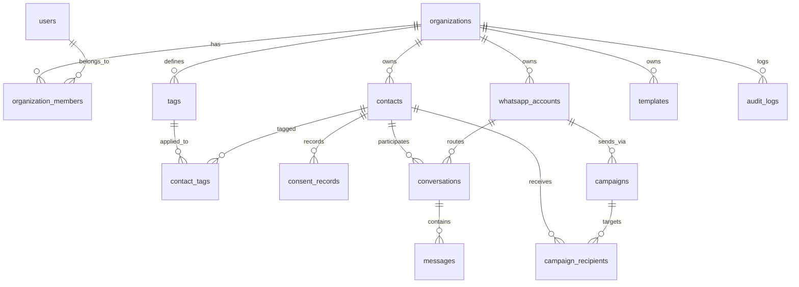

# Database Design Proposal — Cloudflare D1 (Phase 0)

**Audit Date:** 2026-11-26  
**Status:** **PROPOSAL ONLY** — No D1 database, tables, or migrations have been created in Phase 0.  
**Target Stack:** Cloudflare D1 (SQLite) managed with **Drizzle ORM** and versioned SQL migrations.

---

## 1. Entity Relationship Overview



---

## 2. Multi-Tenant Isolation Strategy

1. **Logical Isolation via `organization_id`:** Every tenant-owned table carries a `NOT NULL` `organization_id` foreign key referencing `organizations(id)` with `ON DELETE CASCADE`.
2. **Query-Layer Enforcement:** Drizzle repository helpers require a verified `OrgContext` (`organizationId`, `userId`, `role`) derived from the authenticated session + `organization_members` lookup—never from unverified client parameters.
3. **Composite Indexes Leading with `organization_id`:** All hot-path indexes lead with `organization_id` so D1 reads only rows belonging to the active organization, keeping daily row-read counts far below the `5M rows read/day` Free-Tier limit.
4. **Idempotency Constraints:** Unique keys on `messages(idempotency_key)`, `messages(whatsapp_account_id, provider_message_id)`, and `campaign_recipients(campaign_id, contact_id)` prevent duplicate sends on Cloudflare Queue retries.

---

## 3. Proposed D1 Schema (SQLite)

### 3.1 Users, Organizations & Membership
```sql
CREATE TABLE users (
  id TEXT PRIMARY KEY,
  email TEXT NOT NULL UNIQUE,
  name TEXT NOT NULL,
  password_hash TEXT,                    -- PBKDF2-SHA256; NULL if OAuth-only
  avatar_url TEXT,
  email_verified_at INTEGER,
  created_at INTEGER NOT NULL,
  updated_at INTEGER NOT NULL
);

CREATE TABLE sessions (
  id TEXT PRIMARY KEY,
  user_id TEXT NOT NULL REFERENCES users(id) ON DELETE CASCADE,
  token_hash TEXT NOT NULL UNIQUE,
  active_organization_id TEXT REFERENCES organizations(id) ON DELETE SET NULL,
  client_type TEXT NOT NULL DEFAULT 'web', -- 'web' | 'desktop'
  expires_at INTEGER NOT NULL,
  created_at INTEGER NOT NULL
);
CREATE INDEX idx_sessions_user ON sessions(user_id);

CREATE TABLE organizations (
  id TEXT PRIMARY KEY,
  name TEXT NOT NULL,
  slug TEXT NOT NULL UNIQUE,
  plan_tier TEXT NOT NULL DEFAULT 'free', -- 'free' | 'starter' | 'pro'
  default_country_code TEXT NOT NULL DEFAULT '92',
  timezone TEXT NOT NULL DEFAULT 'Asia/Karachi',
  created_at INTEGER NOT NULL,
  updated_at INTEGER NOT NULL
);

CREATE TABLE organization_members (
  id TEXT PRIMARY KEY,
  organization_id TEXT NOT NULL REFERENCES organizations(id) ON DELETE CASCADE,
  user_id TEXT NOT NULL REFERENCES users(id) ON DELETE CASCADE,
  role TEXT NOT NULL DEFAULT 'agent' CHECK (role IN ('owner', 'admin', 'agent', 'viewer')),
  invited_by TEXT REFERENCES users(id) ON DELETE SET NULL,
  created_at INTEGER NOT NULL,
  UNIQUE(organization_id, user_id)
);
CREATE INDEX idx_org_members_user ON organization_members(user_id);
```

### 3.2 WhatsApp Accounts (Provider Separation)
Official Meta Cloud API (`official_meta_cloud`) is the commercial default. Optional local/unofficial connectors (`unofficial_local_desktop`, `unofficial_bridge`) are strictly isolated and require explicit risk acknowledgment.

```sql
CREATE TABLE whatsapp_accounts (
  id TEXT PRIMARY KEY,
  organization_id TEXT NOT NULL REFERENCES organizations(id) ON DELETE CASCADE,
  label TEXT NOT NULL,
  provider_type TEXT NOT NULL CHECK (provider_type IN ('official_meta_cloud', 'unofficial_local_desktop', 'unofficial_bridge')),
  phone_number TEXT,                     -- Normalized E.164 digits
  connection_status TEXT NOT NULL DEFAULT 'disconnected', -- 'connected' | 'disconnected' | 'qr_pending' | 'error'

  -- Official Meta Cloud API credentials (NULL for unofficial)
  meta_waba_id TEXT,
  meta_phone_number_id TEXT UNIQUE,
  meta_access_token_enc TEXT,            -- AES-256-GCM encrypted
  meta_app_secret_enc TEXT,              -- AES-256-GCM encrypted
  meta_webhook_verify_hash TEXT,

  -- Optional Unofficial Connector metadata (NULL for official_meta_cloud)
  unofficial_risk_accepted_at INTEGER,
  unofficial_device_id TEXT,
  unofficial_bridge_url TEXT,
  unofficial_bridge_secret_enc TEXT,
  last_heartbeat_at INTEGER,

  is_default INTEGER NOT NULL DEFAULT 0,
  created_at INTEGER NOT NULL,
  updated_at INTEGER NOT NULL
);
CREATE INDEX idx_wa_accounts_org ON whatsapp_accounts(organization_id);
```

### 3.3 Contacts, Tags, Lists & Consent Records
```sql
CREATE TABLE contacts (
  id TEXT PRIMARY KEY,
  organization_id TEXT NOT NULL REFERENCES organizations(id) ON DELETE CASCADE,
  phone TEXT NOT NULL,                   -- Normalized digits
  raw_phone TEXT,
  name TEXT NOT NULL DEFAULT 'Valued Client',
  email TEXT,
  company TEXT,
  custom_attributes_json TEXT NOT NULL DEFAULT '{}',
  pipeline_stage TEXT NOT NULL DEFAULT 'lead', -- 'lead' | 'contacted' | 'qualified' | 'won' | 'lost'
  source TEXT NOT NULL DEFAULT 'manual', -- 'manual' | 'csv' | 'excel' | 'google_sheet' | 'inbound' | 'legacy_import'
  last_inbound_at INTEGER,
  last_outbound_at INTEGER,
  created_at INTEGER NOT NULL,
  updated_at INTEGER NOT NULL,
  UNIQUE(organization_id, phone)
);
CREATE INDEX idx_contacts_org_stage ON contacts(organization_id, pipeline_stage);
CREATE INDEX idx_contacts_org_updated ON contacts(organization_id, updated_at DESC);

CREATE TABLE tags (
  id TEXT PRIMARY KEY,
  organization_id TEXT NOT NULL REFERENCES organizations(id) ON DELETE CASCADE,
  name TEXT NOT NULL,
  color TEXT NOT NULL DEFAULT '#00a884',
  created_at INTEGER NOT NULL,
  UNIQUE(organization_id, name)
);

CREATE TABLE contact_tags (
  organization_id TEXT NOT NULL REFERENCES organizations(id) ON DELETE CASCADE,
  contact_id TEXT NOT NULL REFERENCES contacts(id) ON DELETE CASCADE,
  tag_id TEXT NOT NULL REFERENCES tags(id) ON DELETE CASCADE,
  created_at INTEGER NOT NULL,
  PRIMARY KEY (contact_id, tag_id)
);
CREATE INDEX idx_contact_tags_org ON contact_tags(organization_id, tag_id);

CREATE TABLE contact_lists (
  id TEXT PRIMARY KEY,
  organization_id TEXT NOT NULL REFERENCES organizations(id) ON DELETE CASCADE,
  name TEXT NOT NULL,
  source_type TEXT NOT NULL DEFAULT 'manual', -- 'manual' | 'csv' | 'excel' | 'google_sheet'
  source_url TEXT,
  auto_sync_enabled INTEGER NOT NULL DEFAULT 0,
  sync_interval_min INTEGER NOT NULL DEFAULT 5,
  last_synced_at INTEGER,
  last_sync_error TEXT,
  created_at INTEGER NOT NULL,
  updated_at INTEGER NOT NULL
);

CREATE TABLE list_members (
  organization_id TEXT NOT NULL REFERENCES organizations(id) ON DELETE CASCADE,
  list_id TEXT NOT NULL REFERENCES contact_lists(id) ON DELETE CASCADE,
  contact_id TEXT NOT NULL REFERENCES contacts(id) ON DELETE CASCADE,
  added_at INTEGER NOT NULL,
  PRIMARY KEY (list_id, contact_id)
);

CREATE TABLE consent_records (
  id TEXT PRIMARY KEY,
  organization_id TEXT NOT NULL REFERENCES organizations(id) ON DELETE CASCADE,
  contact_id TEXT NOT NULL REFERENCES contacts(id) ON DELETE CASCADE,
  channel TEXT NOT NULL DEFAULT 'whatsapp',
  status TEXT NOT NULL CHECK (status IN ('opted_in', 'opted_out', 'unknown')),
  source TEXT NOT NULL,                  -- 'web_form' | 'inbound_message' | 'stop_keyword' | 'manual_import'
  proof_note TEXT,
  recorded_by_user_id TEXT REFERENCES users(id) ON DELETE SET NULL,
  recorded_at INTEGER NOT NULL
);
CREATE INDEX idx_consent_org_contact ON consent_records(organization_id, contact_id, recorded_at DESC);
```

### 3.4 Conversations & Messages
```sql
CREATE TABLE conversations (
  id TEXT PRIMARY KEY,
  organization_id TEXT NOT NULL REFERENCES organizations(id) ON DELETE CASCADE,
  whatsapp_account_id TEXT NOT NULL REFERENCES whatsapp_accounts(id) ON DELETE CASCADE,
  contact_id TEXT NOT NULL REFERENCES contacts(id) ON DELETE CASCADE,
  status TEXT NOT NULL DEFAULT 'open' CHECK (status IN ('open', 'pending', 'resolved', 'snoozed')),
  handler_mode TEXT NOT NULL DEFAULT 'human' CHECK (handler_mode IN ('human', 'ai_bot')),
  assigned_user_id TEXT REFERENCES users(id) ON DELETE SET NULL,
  service_window_expires_at INTEGER,     -- Meta 24h customer care window end (last_inbound_at + 24h)
  unread_count INTEGER NOT NULL DEFAULT 0,
  last_message_preview TEXT,
  last_message_at INTEGER,
  created_at INTEGER NOT NULL,
  updated_at INTEGER NOT NULL,
  UNIQUE(organization_id, whatsapp_account_id, contact_id)
);
CREATE INDEX idx_conv_org_inbox ON conversations(organization_id, status, last_message_at DESC);

CREATE TABLE messages (
  id TEXT PRIMARY KEY,
  organization_id TEXT NOT NULL REFERENCES organizations(id) ON DELETE CASCADE,
  conversation_id TEXT NOT NULL REFERENCES conversations(id) ON DELETE CASCADE,
  whatsapp_account_id TEXT NOT NULL REFERENCES whatsapp_accounts(id) ON DELETE CASCADE,
  direction TEXT NOT NULL CHECK (direction IN ('inbound', 'outbound', 'internal_note')),
  sender_kind TEXT NOT NULL CHECK (sender_kind IN ('contact', 'agent', 'ai_bot', 'campaign', 'system')),
  sender_user_id TEXT REFERENCES users(id) ON DELETE SET NULL,
  msg_type TEXT NOT NULL DEFAULT 'text',
  body TEXT,
  media_r2_key TEXT,
  provider_message_id TEXT,              -- Meta wamid or external provider ID
  idempotency_key TEXT UNIQUE,
  delivery_status TEXT NOT NULL DEFAULT 'pending', -- 'pending' | 'queued' | 'sent' | 'delivered' | 'read' | 'failed'
  error_code TEXT,
  error_message TEXT,
  campaign_id TEXT REFERENCES campaigns(id) ON DELETE SET NULL,
  created_at INTEGER NOT NULL,
  updated_at INTEGER NOT NULL
);
CREATE INDEX idx_msg_conv ON messages(organization_id, conversation_id, created_at ASC);
CREATE UNIQUE INDEX idx_msg_provider_dedup ON messages(whatsapp_account_id, provider_message_id) WHERE provider_message_id IS NOT NULL;
```

### 3.5 Templates, Campaigns & Durable Recipients
```sql
CREATE TABLE templates (
  id TEXT PRIMARY KEY,
  organization_id TEXT NOT NULL REFERENCES organizations(id) ON DELETE CASCADE,
  whatsapp_account_id TEXT REFERENCES whatsapp_accounts(id) ON DELETE CASCADE,
  name TEXT NOT NULL,
  language TEXT NOT NULL DEFAULT 'en',
  category TEXT NOT NULL DEFAULT 'UTILITY', -- 'UTILITY' | 'MARKETING' | 'AUTHENTICATION' | 'CUSTOM_TEXT'
  body_text TEXT NOT NULL,
  header_json TEXT,
  buttons_json TEXT,
  meta_template_id TEXT,
  approval_status TEXT NOT NULL DEFAULT 'LOCAL', -- 'LOCAL' | 'PENDING' | 'APPROVED' | 'REJECTED'
  created_at INTEGER NOT NULL,
  updated_at INTEGER NOT NULL
);
CREATE INDEX idx_templates_org ON templates(organization_id, approval_status);

CREATE TABLE campaigns (
  id TEXT PRIMARY KEY,
  organization_id TEXT NOT NULL REFERENCES organizations(id) ON DELETE CASCADE,
  whatsapp_account_id TEXT NOT NULL REFERENCES whatsapp_accounts(id) ON DELETE CASCADE,
  list_id TEXT REFERENCES contact_lists(id) ON DELETE SET NULL,
  template_id TEXT REFERENCES templates(id) ON DELETE SET NULL,
  name TEXT NOT NULL,
  message_override TEXT,
  status TEXT NOT NULL DEFAULT 'draft' CHECK (status IN ('draft', 'scheduled', 'running', 'paused', 'completed', 'cancelled', 'failed')),
  schedule_type TEXT NOT NULL DEFAULT 'immediate' CHECK (schedule_type IN ('immediate', 'once', 'recurring')),
  scheduled_at INTEGER,                  -- UTC epoch ms; polled by Cron Trigger
  recurrence_cron TEXT,
  total_recipients INTEGER NOT NULL DEFAULT 0,
  sent_count INTEGER NOT NULL DEFAULT 0,
  delivered_count INTEGER NOT NULL DEFAULT 0,
  failed_count INTEGER NOT NULL DEFAULT 0,
  skipped_count INTEGER NOT NULL DEFAULT 0,
  created_by_user_id TEXT REFERENCES users(id) ON DELETE SET NULL,
  created_at INTEGER NOT NULL,
  updated_at INTEGER NOT NULL
);
CREATE INDEX idx_campaigns_schedule ON campaigns(status, scheduled_at);
CREATE INDEX idx_campaigns_org ON campaigns(organization_id, created_at DESC);

CREATE TABLE campaign_recipients (
  id TEXT PRIMARY KEY,
  organization_id TEXT NOT NULL REFERENCES organizations(id) ON DELETE CASCADE,
  campaign_id TEXT NOT NULL REFERENCES campaigns(id) ON DELETE CASCADE,
  contact_id TEXT NOT NULL REFERENCES contacts(id) ON DELETE CASCADE,
  phone TEXT NOT NULL,
  status TEXT NOT NULL DEFAULT 'pending' CHECK (status IN ('pending', 'queued', 'queued_on_device', 'sent', 'delivered', 'read', 'failed', 'skipped')),
  idempotency_key TEXT NOT NULL UNIQUE,
  provider_message_id TEXT,
  error_message TEXT,
  attempt_count INTEGER NOT NULL DEFAULT 0,
  next_attempt_at INTEGER,
  sent_at INTEGER,
  updated_at INTEGER NOT NULL,
  UNIQUE(campaign_id, contact_id)
);
CREATE INDEX idx_cr_due ON campaign_recipients(campaign_id, status, next_attempt_at);
```

### 3.6 AI Support Bot, Usage Quotas & Audit Logs
```sql
CREATE TABLE ai_agents (
  id TEXT PRIMARY KEY,
  organization_id TEXT NOT NULL REFERENCES organizations(id) ON DELETE CASCADE,
  name TEXT NOT NULL,
  system_prompt TEXT NOT NULL,
  model_id TEXT NOT NULL DEFAULT '@cf/meta/llama-3.1-8b-instruct-fast',
  is_enabled INTEGER NOT NULL DEFAULT 0,
  handoff_keywords_json TEXT NOT NULL DEFAULT '["agent","human","representative","complaint"]',
  created_at INTEGER NOT NULL,
  updated_at INTEGER NOT NULL
);

CREATE TABLE knowledge_docs (
  id TEXT PRIMARY KEY,
  organization_id TEXT NOT NULL REFERENCES organizations(id) ON DELETE CASCADE,
  ai_agent_id TEXT NOT NULL REFERENCES ai_agents(id) ON DELETE CASCADE,
  title TEXT NOT NULL,
  content TEXT NOT NULL,
  r2_key TEXT,
  created_at INTEGER NOT NULL
);

CREATE VIRTUAL TABLE knowledge_fts USING fts5(
  doc_id UNINDEXED,
  organization_id UNINDEXED,
  title,
  content
);

CREATE TABLE usage_counters (
  organization_id TEXT NOT NULL REFERENCES organizations(id) ON DELETE CASCADE,
  period_key TEXT NOT NULL,              -- e.g. '2026-11-26' or '2026-11'
  outbound_messages INTEGER NOT NULL DEFAULT 0,
  ai_replies INTEGER NOT NULL DEFAULT 0,
  ai_neurons_est INTEGER NOT NULL DEFAULT 0,
  PRIMARY KEY (organization_id, period_key)
);

CREATE TABLE audit_logs (
  id TEXT PRIMARY KEY,
  organization_id TEXT NOT NULL REFERENCES organizations(id) ON DELETE CASCADE,
  actor_user_id TEXT REFERENCES users(id) ON DELETE SET NULL,
  action TEXT NOT NULL,                  -- e.g. 'channel.connected', 'campaign.launched', 'member.invited'
  entity_type TEXT NOT NULL,
  entity_id TEXT,
  metadata_json TEXT,
  ip_address TEXT,
  created_at INTEGER NOT NULL
);
CREATE INDEX idx_audit_org_time ON audit_logs(organization_id, created_at DESC);
```

---

## Phase 2 Implemented Schema Notes (2026-11-26)
- Applied in `packages/db/migrations/0003_phase2_crm.sql` (local SQLite test verified; no remote D1 database created yet):
  - `contacts` uses partial unique index `WHERE deleted_at IS NULL` so soft-deleted contacts do not block re-creation.
  - `consent_records` uses `contact_id REFERENCES contacts(id) ON DELETE SET NULL` paired with `suppression_list (organization_id, phone)` so `STOP` opt-outs survive contact deletion.
  - `conversations.channel_type` temporarily uses `'official_meta_cloud' | 'unofficial_local_desktop' | 'manual_crm'` until Phase 3 introduces `whatsapp_accounts`.
  - Added `legacy_imports` to track migrated `Orchestrator.state` templates, sheet URLs, and batch counters.
